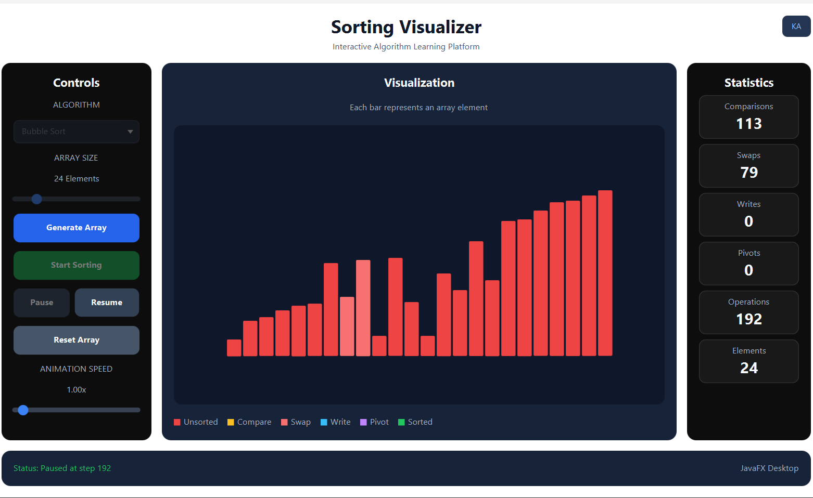
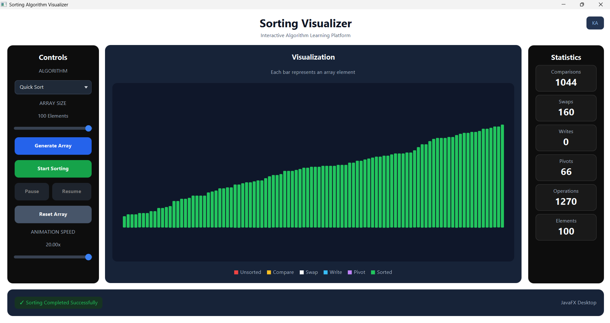

# Sorting Visualizer

**An interactive JavaFX desktop application for understanding sorting algorithms, one operation at a time.**


Sorting Visualizer makes it easier to see **how arrays change during sorting**, rather than looking only at the final output. Choose an algorithm, generate an array, adjust the playback speed, and follow comparisons, swaps, writes, and pivot selections as they happen.

## Preview



*Sorting in progress, with highlighted operations and live statistics.*

## Features

- **Five sorting algorithms:** Bubble, Selection, Insertion, Merge, and Quick Sort.
- **Live bar visualization** with separate colors for different operations.
- **Customizable array size:** 10–100 elements (24 by default).
- **Adjustable playback speed:** 0.25x–20x, including changes during playback.
- **Playback controls:** Start, Pause, Resume, Reset, and Generate Array.
- **Live statistics:** Comparisons, swaps, writes, pivot selections, and total operations.
- **Element tooltips:** Hover over a bar to inspect its index and value.
- **Resizable desktop layout** with bars calculated to fit the available chart width.
- **Completion feedback:** Sorted bars turn green and the status bar confirms completion.
- **Dark-themed controls and statistics panels**, styled with a JavaFX CSS stylesheet.

## Supported algorithms

| Algorithm | Best time | Average time | Worst time | Extra space* |
| --- | --- | --- | --- | --- |
| Bubble Sort | O(n) | O(n²) | O(n²) | O(1) |
| Selection Sort | O(n²) | O(n²) | O(n²) | O(1) |
| Insertion Sort | O(n) | O(n²) | O(n²) | O(1) |
| Merge Sort | O(n log n) | O(n log n) | O(n log n) | O(n) |
| Quick Sort | O(n log n) | O(n log n) | O(n²) | O(log n) average; O(n) worst |

*Complexities describe the underlying sorting algorithms. They exclude the additional memory used to record visualization events. Quick Sort in this project selects the first element of each partition as its pivot.*

### Visualization colors

| Color | Meaning |
| --- | --- |
| 🔴 Red | Normal / unsorted bar |
| 🟡 Yellow | Comparison |
| ⚪ White | Swap |
| 🔵 Cyan | Write |
| 🟣 Purple | Pivot |
| 🟢 Green | Sorting completed |

## Getting started

### Requirements

- **JDK 25** (the Maven compiler target is Java 25).
- **Apache Maven** installed and available in your terminal.
- A desktop environment capable of running JavaFX applications.

JavaFX dependencies are declared in `pom.xml` and are resolved through Maven.

### Run locally

1. Clone the repository:

   ```bash
   git clone https://github.com/abdkhalidabdullah123-ship-it/Sorting-Algorithm-Visualizer.git
   cd Sorting-Algorithm-Visualizer
   ```

2. Start the desktop application:

   ```bash
   mvn clean javafx:run
   ```

3. In the app, choose a sorting algorithm, adjust **Array Size** and **Animation Speed**, click **Generate Array**, then **Start Sorting**.

> **Note:** This is a JavaFX desktop project, not a web application. The repository does not currently provide a packaged Windows installer; run it through Maven using the command above.

## How to use

| Control | Action |
| --- | --- |
| **Algorithm** | Choose one of the five sorting algorithms. |
| **Array Size** | Select 10–100 elements; click **Generate Array** to apply the new size. |
| **Generate Array** | Create a new random array and clear the previous playback state. |
| **Start Sorting** | Start visualizing the selected algorithm. |
| **Pause / Resume** | Pause or continue the animation. |
| **Reset Array** | Restore the original values from the current generated array. |
| **Animation Speed** | Adjust playback speed from 0.25x to 20x, even during sorting. |

The statistics panel updates during playback. Once sorting completes successfully, the bars turn green.

## How it works

```text
Generate Array
     |
     v
SortingAlgorithms  --->  records SortingStep events
     |                     (COMPARE / SWAP / WRITE / PIVOT / DONE)
     v
SortingController  --->  replays the events with a JavaFX Timeline
     |
     v
MainApp            --->  updates bars, highlights, statistics, and status
```

The sorting engine operates on a **clone of the input array**. The controller replays the recorded events on its own displayed array state, while the JavaFX interface draws the current step. This keeps the algorithm implementation separate from the visualization.

## Project structure

```text
Sorting-Algorithm-Visualizer/
├── pom.xml
├── README.md
├── docs/
│   └── screenshots/
│       ├── sorting-in-progress.png
│       └── sorting-completed.png
└── src/
    ├── main/
    │   ├── java/org/khalid/sorting/
    │   │   ├── MainApp.java
    │   │   ├── SortingAlgorithms.java
    │   │   ├── SortingController.java
    │   │   ├── SortingStep.java
    │   │   ├── SortingStats.java
    │   │   └── SortingTest.java
    │   └── resources/
    │       └── style.css
    └── test/java/org/khalid/sorting/
        └── SortingAlgorithmsTest.java
```

## Testing

Run the included JUnit tests:

```bash
mvn test
```

The unit tests cover correctness across random, already-sorted, reverse-sorted, duplicate, empty, single-element, and negative-number arrays. They also verify that the original input is not modified, that sorting records a `DONE` event, and that replaying recorded operations reproduces the sorted result.

The desktop interface has also been manually checked for sorting playback, Pause/Resume, Reset, high-speed operation, 100-element arrays, and window resizing.

## Completed sort



*Quick Sort completed on 100 elements, with the final bars shown in green.*

---

**Built with Java, JavaFX, Maven, and a focus on making sorting algorithms easier to understand visually.**
